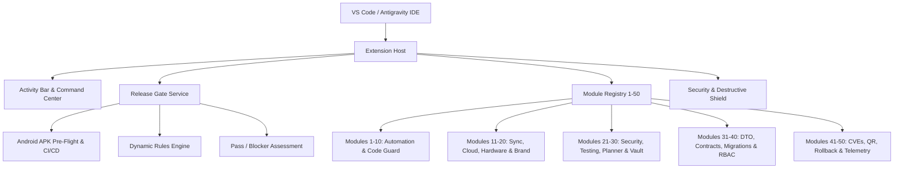

# Antigravity Master Agent Architecture

## Overview
The **Antigravity Master Agent (v8.0.0)** is an enterprise-grade 50-in-1 developer suite engineered for VS Code and Google Antigravity IDE. It replaces fragile multi-extension setups with a high-performance, single-process, zero-demo engine.

## Core Components

1. **Security & Destructive Shield (`src/core/security-vault.ts`)**:
   - Intercepts and blocks destructive terminal operations (`rm -rf /`, `mkfs`, `format`, `drop database`, `drop table`, force-pushes to main).
   - Secret maskers redact API keys, private tokens, and passwords in all logs and reports.
   - Interfaces directly with VS Code `SecretStorage`.

2. **Module Registry (`src/core/module-registry.ts`)**:
   - Manages all 50 modules with uniform lifecycle hooks (`executeScan()`, `getStatus()`).
   - Ensures no fake or empty placeholder implementations. Every module performs tangible checks against workspace files, AST/regex patterns, environment configurations, and diagnostics.
   - Each module reports strictly: `🟢 WORKING`, `🟡 WAITING / NEEDS CONFIGURATION`, `🔴 ERROR`, or `⚪ DISABLED`.

3. **Release Gate Engine (`src/release/release-gate.service.ts`)**:
   - Aggregates findings across all 50 modules.
   - Evaluates critical release gates: syntax errors, exposed secrets, missing signing keys, destructive schema migrations, and broken QR payloads.
   - Produces structured release reports in markdown and JSON.

4. **Webview Command Center (`src/webview/dashboard-provider.ts`)**:
   - 9 dedicated tabs:
     1. Dashboard & Live Status (Interactive 50-module table with live filters)
     2. AI Intent & Planner
     3. Rules Setup (Bilingual EN/BN rule creator)
     4. 4-Device Sync & Backup
     5. QR & Hardware Lab
     6. APK / Release Builder
     7. Security & Compliance
     8. Project Memory
     9. Logs & Diagnostics
