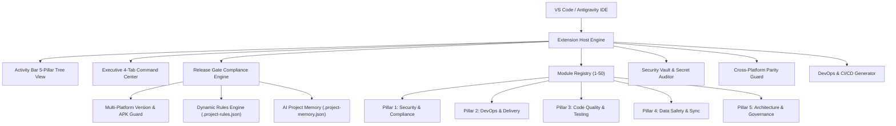

# Antigravity Master Agent Architecture

## Overview
The **Antigravity Master Agent (v8.0.0)** is an enterprise-grade 50-in-1 developer suite engineered for VS Code and Google Antigravity IDE. It replaces fragile multi-extension setups with a high-performance, single-process, zero-demo engine adhering strictly to universal enterprise rules.

---

## The 5 Pillars of Enterprise Compliance

All 50 diagnostic and enforcement modules are grouped into 5 strategic pillars:

1. **Security & Compliance (Pillar 1)**:
   - Secret masking, destructive command interceptor, OWASP vulnerability scanner, rate limiting, and RBAC audit trail verification.
2. **DevOps & Delivery (Pillar 2)**:
   - Android APK pre-flight, signing key validation, ProGuard analysis, multi-platform CI/CD generator (`android-release.yml`, `web-vercel-deploy.yml`, `desktop-build.yml`, `dispatch-build.yml`), and release gate assertion.
3. **Code Quality & Testing (Pillar 3)**:
   - Formatter on save, empty callback detection (`onPressed: () {}`), test coverage auditor, localization validator (Bengali/English), and dead code purger.
4. **Data Safety & Sync (Pillar 4)**:
   - Encrypted local/cloud backup engine, GZIP compression, SHA-256 verification, mock restore runner, multi-tenant isolation guard (`tenant_id`), and offline sync verification.
5. **Architecture & Governance (Pillar 5)**:
   - Cross-platform DTO and schema parity (Prisma, SQL, Dart, TS), zero-demo enforcement, monetary precision auditor (preventing float bugs), and AI memory bank.

---

## Core Components

### 1. Activity Bar 5-Pillar Tree View (`src/views/pillar-tree.provider.ts`)
- Native VS Code `TreeDataProvider` providing zero-latency status directly in the editor sidebar.
- Displays Live Health Score, Quick Actions menu, and 5 collapsible pillars with live status icons (`pass-filled`, `warning`, `error`, `clock`).
- Clicking any module displays full details and remediation options.

### 2. Executive 4-Tab Webview Command Center (`src/webview/dashboard-html.ts`)
- **Tab 1: Overview & Health**: Live SVG circular compliance meter (0-100%), 5-pillar health radar, quick metrics cards, and 1-Click Auto-Heal.
- **Tab 2: Guard 1-50**: Accordion grouping of all 50 modules with live search, status filtering, and individual scan buttons.
- **Tab 3: DevOps & Lab**: Automated backup/restore simulation, secret auditor, dependency scanner, APK signing inspector, and QR code generator.
- **Tab 4: Rules & AI**: Custom rule manager, industry rule templates (POS, Samity, Agro, Diagnostic, CRM), and AI project memory viewer.

### 3. Editor Intelligence Providers
- **Lightbulb QuickFix Provider (`src/editor/code-action.provider.ts`)**: Injects `Ctrl+.` quick-fixes for `.gitignore` secrets, `.project-memory.json`, empty button handlers, unpinned dependencies, and missing `tenant_id` database queries.
- **Enterprise CodeLens Provider (`src/editor/codelens.provider.ts`)**: Inline status indicators displayed above code files confirming active enterprise compliance.

### 4. Cross-Platform Parity Guard (`src/core/parity-guard.service.ts`)
- Analyzes Prisma schemas, SQL DDL files, Dart model classes, and TypeScript interfaces to guarantee field name and type synchronization across web, mobile, and backend.

### 5. Multi-Platform Version Synchronizer (`src/android/apk-preflight.ts`)
- Automatically keeps `package.json`, `package-lock.json`, Flutter `pubspec.yaml`, Android `build.gradle` / `build.gradle.kts`, Tauri `tauri.conf.json`, and `.version.json` in sync.
